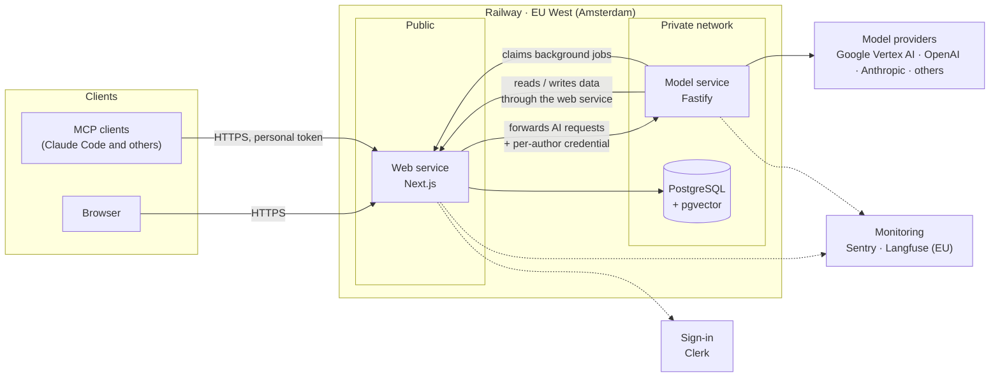

# Architecture

Loomnovel runs as two services and a database on Railway, in the EU West region (Amsterdam). Only the web service has a public address.

This page is an overview of how Loomnovel's services are built, so that they are more transparent to you.

## Overview

## Components

| Part | What it does | What it does not do |
|---|---|---|
| **Web service** (Next.js) | Pages; sign-in through Clerk; the data API for books, chapters, worldbooks, conversations and memory; quotas and the cost ledger; the background job table; registering, stopping and resuming agent runs; writing accepted proposals to the database. Forwards every AI request to the model service, same-origin, with a short-lived credential for the signed-in author. | Call models. |
| **Model service** (Fastify) | Every AI task: drafting, revision, review, chapter planning, worldbook retrieval and upkeep, each turn of the agent. Also the remote MCP endpoint and the background-job worker. | Connect to the database. It reads and writes book data only through the web service's data API, as the author named in the credential. |
| **Database** (PostgreSQL + pgvector) | All persistent data, version history, the cost ledger, and the vector indexes used to recall earlier chapters and worldbook entries. | Serve other services: only the web service can connect to it. |
| **Shared packages** | Request and response contracts used by both services; a model gateway (model registry with prices, provider adapters, prompt loading with versions, cost accounting); the database schema. | — |

Prompts are template files on the server, loaded at runtime, and never shipped with the browser bundle. Every build compares the browser bundle against sentences from the prompt files.

## Every way in, one implementation

The four web entry points and MCP all call the same server-side capabilities. Early on, each entry point had its own implementation; merging them was the main goal of the October 2026 rebuild ([decision 0003](decisions/0003-run-the-agent-on-the-server.md), [decision 0004](decisions/0004-rebuild-after-architecture-audit.md)).

Two kinds of work sit on top of those capabilities:

- **The agent** talks with the author and calls tools. Its changes are proposals, applied by the server: after the author's click by default, or by itself within a budget in auto mode.
- **Fixed workflows**: chapter planning, drafting and review. They follow how professional authors plan and revise, and they are the same whether the agent, the web page or an MCP client starts them.

When a model writes or reviews, its context is assembled in layers: fixed documents (the author's settings, outline, style), a snapshot of the story state, and passages recalled by vector search from earlier chapters and the worldbook.

## Background work

Slow follow-up work goes into a job table in the database and is picked up by a worker in the model service, so a page request never waits for it. Examples: indexing a saved chapter for recall, writing chapter summaries, compacting long conversations, archiving idle ones. Agent runs also execute on the server: closing the page does not stop them.

## Deployment on Railway

| Service | How it runs | Network |
|---|---|---|
| Web | Docker image built from the repository | Public domain (loomnovel.com), plus the private network |
| Model service | Docker image built from the repository | Private network only. Railway's private network is IPv6, so the service listens on IPv6. |
| PostgreSQL | Railway's managed PostgreSQL with the pgvector extension | Private network only |

- **Release path.** Releases go out from a dedicated deploy branch, so untracked local files cannot end up in a build. A push to that branch runs the pipeline: type checks and the test suite, then database migrations, then the model service, then the web service. The model service goes first because new web code may depend on new model-service capabilities.
- **Migrations** are applied by the pipeline before the new code goes live. The October 2026 release changed the schema; before it, the production database was backed up, the backup was restored into a scratch database and checked against production, and only then were the migrations run.
- **Draining.** On redeploy, the model service gets 30 seconds to finish running work before it stops.

## Observability

- **Errors:** Sentry, EU region, both services.
- **Model calls:** Langfuse, EU region. Metadata only (model, tokens, latency, cost), no manuscript text.
- **Cost ledger:** the server writes one row per model call, with token counts, latency, the feature that triggered it and the model actually used, priced at the provider's list price. Quotas and budgets are checked before a call is made.

## Performance

| Measurement | Result | Conditions |
|---|---|---|
| Prompt cache, agent chat | 99.5% of input tokens served from cache on the second turn; 99.7% on the third after a later change | July 2026, measured after each change |
| Prompt cache, repeated request | 98.1% served from cache | July 2026, the same request re-sent to the model that had a zero hit rate before the fix |
| Switching chapters in a 697-chapter book | Response size 4.95 MB → 0.10 MB; time 391 ms → 153 ms | July 2026, load-test book, after the chapter list was limited to metadata |

## Stack

TypeScript throughout. Next.js and React, Fastify, PostgreSQL with pgvector, Prisma, Docker, Vitest. Hosted on Railway.
