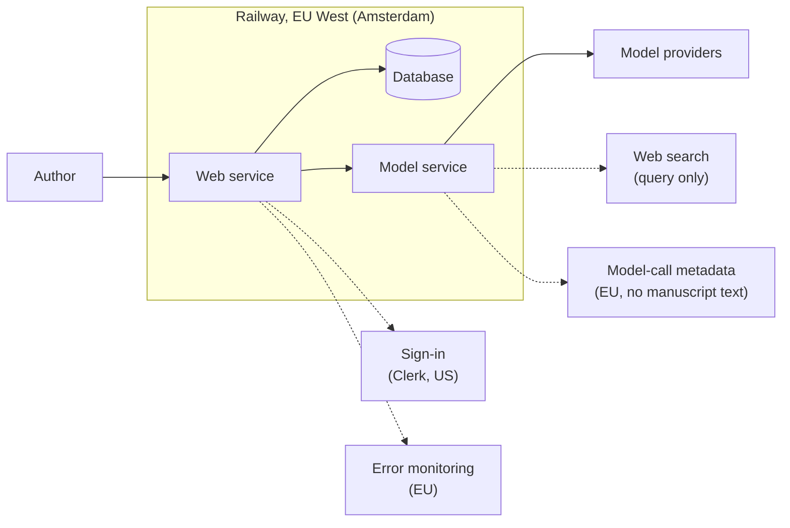

# Data and privacy

Where your text goes, how long it is kept and how to take it with you, in one diagram. What each provider receives and does with it is listed under [Providers](#providers) at the end of this page.

## Where your text goes

- The web service, the model service and the database are hosted on Railway in the EU West region (Amsterdam).
- To run an AI feature, only the text that feature needs is sent to the corresponding model provider. What each one receives, whether it may train on it, and how long it keeps it are listed under [Providers](#providers) at the end of this page.
- Sign-in is handled by Clerk, in the United States. It receives only your email address and login data, and never touches your books.
- Web search is used only when you ask for it, and sends the search query, not your manuscript.
- Error monitoring (Sentry) and model-call monitoring (Langfuse) run in the EU and receive only metadata (model, tokens, timing, cost), not manuscript text.

## What is kept, and for how long

| Data | Kept |
|---|---|
| Books, chapters, worldbooks, conversations | Until you delete them or close your account |
| Deleted projects | 30 days in the recycle bin, where you can restore them; then removed for good, and the copy in the backups is deleted at the same time |
| Reference texts uploaded for style analysis | Deleted within 24 hours; only a hash is kept |
| Cost ledger (one row per model call) | Kept for cost accounting and abuse checks; it records which feature and which model were used, not the text |

## Export and deletion

- You can export a whole book from the chapter view.
- You can delete a project yourself. To close your account or have all your data deleted, write to founder@loomnovel.com.

## Training

We (Loomnovel) do not train models on your manuscript, and we do not use it to improve the services we provide. What each model provider does is listed under [Providers](#providers).

## Backups

The database is backed up every day to encrypted off-site storage in the EU. When a project is deleted for good, its copy in the backups is deleted with it; only the recycle bin keeps it, for 30 days. Restores have been rehearsed: before the release on 18 October 2026, a full backup was restored into a scratch database, and its row counts and checksums matched production.

## Providers

When you use an AI feature, the text that step needs is sent to the corresponding provider below. How each one treats that text is governed by its own API terms; the table summarizes each provider's official terms, as checked on 4 November 2026.

| Provider | What we use it for | What it receives | Does it train on it? | How long it keeps it | Where it is processed | Terms |
|---|---|---|---|---|---|---|
| Google Cloud Vertex AI (Gemini) | Main writing and editing models | The manuscript excerpts that step needs | No. Customer data is not used to train or fine-tune any model without the customer's permission | Only requests flagged as suspicious are kept, for up to 90 days, for abuse review; cached data for up to 24 hours | Google Cloud | [Service Terms §18](https://cloud.google.com/terms/service-terms) |
| OpenAI | Economy-tier writing and structured processing | Conversation and manuscript excerpts | No. Since March 2023, API data is not used for training by default | Abuse-monitoring logs for up to 30 days | US company, processed globally | [Your data](https://developers.openai.com/api/docs/guides/your-data) |
| Anthropic (Claude) | Revision, de-AI, and optional writing and editing models | The manuscript excerpts that step needs | No. Its commercial terms do not allow training models on customer content | Deleted within 30 days; requests that violate its usage policy for up to 2 years | US company | [Commercial Terms](https://www.anthropic.com/legal/commercial-terms) |
| Zhipu Z.ai (international endpoint) | Parsing imported files and recognizing images | The content of uploaded files | No. Its API developer terms say data is not used to develop or improve its services without explicit consent | Processed in real time, not stored | Singapore | [Terms of Use](https://docs.z.ai/legal-agreement/terms-of-use) |
| Tavily | Web search | Search queries only | By default it may use search queries to improve future results; this can be turned off in the account | For as long as the account exists | United States | [Privacy Policy](https://www.tavily.com/privacy) |
